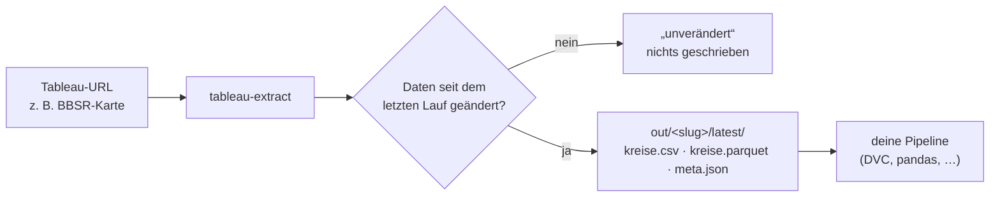
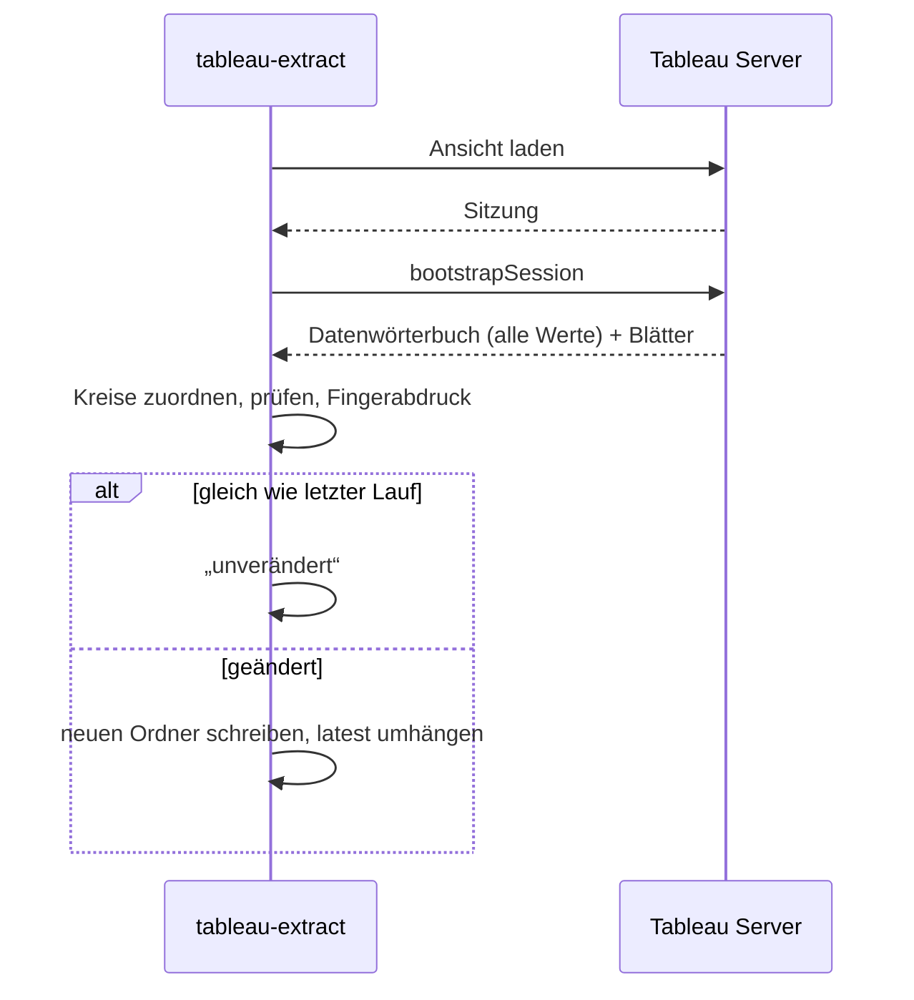

# tableau-extract

Holt die **Daten hinter einer Tableau-Karte** (z. B. BBSR-Wohnungsneubaubedarf je Landkreis) und legt sie als Tabelle ab: eine Zeile je Kreis, Werte exakt wie im Tableau-Datenmodell, nicht von Farben oder Tooltips abgelesen.

> **Status:** in Umsetzung (Branch `feat/tableau-extract`, Spezifikation unter `openspec/changes/add-tableau-extract/`). Die Befehle unten beschreiben das **geplante** Verhalten. Was bereits funktioniert, ist die Zugangsprüfung in `probe/`.

## Auf einen Blick



| | |
|---|---|
| **Eingabe** | eine URL einer Tableau-Ansicht (`https://<server>/t/<site>/views/<Arbeitsmappe>/<Blatt>`) |
| **Ausgabe** | `kreise.csv` und `kreise.parquet` (eine Zeile je Kreis, `ags5` + alle Felder), `meta.json` (Herkunft, Prüfsummen) |
| **Geladen** | nur, wenn die Arbeitsmappe neu veröffentlicht wurde (kleine Vorabprüfung); spätestens alle 30 Tage trotzdem voll, falls die Quelle still aktualisiert wird |
| **Neu geschrieben** | nur, wenn sich mindestens ein Wert geändert hat |
| **Läuft** | lokal bzw. im Homelab. Aus Rechenzentren (GitHub Actions, Cloud-VMs) sperrt der BBSR-Server mit 403, siehe [Zugangsbericht](docs/zugangsbericht.md) |

## Installation

**Im Jupyter-Notebook** (JupyterLab oder VS Code, Python ≥ 3.11), sobald das Repo öffentlich und `v0.1.0` getaggt ist:

```python
%pip install "git+https://github.com/trosinde/tableau-extract.git@v0.1.0"
```

Mit Browser-Rückfallweg (nur nötig, wenn der direkte Abruf scheitert):

```python
%pip install "tableau-extract[browser] @ git+https://github.com/trosinde/tableau-extract.git@v0.1.0"
!playwright install chromium
```

**Für die Entwicklung:**

```bash
git clone https://github.com/trosinde/tableau-extract.git
cd tableau-extract
uv sync --all-groups               # inkl. Tests, Lint, Notebook-Werkzeuge
uv sync --extra browser            # optional: Playwright
```

Die Kreis-Referenzliste wird mitinstalliert. Eine eigene Fassung unter `./config/kreise_<JJJJ>.csv` hat Vorrang.

## Im Jupyter-Notebook

```python
from tableau_extract import extract, list_view

URL = "https://tableau.bbsr.bund.de/t/bbr/views/Wohnungsneubaubedarfe_insgesamt_2023_bis_2030pa_krs_FINAL/DWohnungsneubaubedare_insgesamt"

list_view(URL)            # Blätter, Felder mit Rollen, Filter
r = extract(URL, out="out/", check_sum=320_000)
r                         # kompakte Zusammenfassung: Status, Weg, Blatt, Zeilen, Vollständigkeit, Pfad
```

| Feld | Wert |
|---|---|
| Status | neu |
| Weg | vizql |
| Blatt | Karte |
| Zeilen | 400 (400/400 Kreise, Gebietsstand 2023) |
| Gegenprobe | 316 490 statt 320 000 (−1,1 %) |
| Pfad | out/bbr-…/20261024T120000Z_3fa9c2d1 |

```python
r.df.nlargest(5, "p_wohnungsneubaubedarf_2330_we_pa_je_10000ew")
extract(URL, out="out/").status    # "unverändert": nichts neu geschrieben
```

- Läuft nur von einem Privatanschluss oder im Homelab, **nicht in Google Colab** oder anderen Cloud-Notebooks (die Quelle sperrt Rechenzentren).
- Ein Beispiel-Notebook liegt unter [`notebooks/schnellstart.ipynb`](notebooks/schnellstart.ipynb). CI führt es bei jeder Änderung vollständig aus, mit einer aufgezeichneten Antwort (`TABLEAU_EXTRACT_REPLAY`), weil GitHub Actions die Quelle nicht erreicht.
- Frühere Läufe lassen sich ohne Netzwerk neu auswerten: `extract(URL, replay="out/<slug>/latest/raw")`.

## Verwendung

### 1. Ansicht ansehen: welche Blätter, Felder und Filter gibt es?

```bash
tableau-extract "https://tableau.bbsr.bund.de/t/bbr/views/Wohnungsneubaubedarfe_insgesamt_2023_bis_2030pa_krs_FINAL/DWohnungsneubaubedare_insgesamt" --list
```

```
Blatt: Karte  (gewählt: Geometrie + Kreisschlüssel)
  krs23                                              Schlüssel   integer
  krsname23                                          Name        text
  slk2023                                            Dimension   text
  SUM(P Wohnungsneubaubedarf 2330 We Pa (Round))     Messwert    formatierter Text (en_US)
  SUM(P Wohnungsneubaubedarf 2330 We Pa Je 10000Ew…) Messwert    real
  P Wohnungsneubaubedarf … (Klassen)                 Klasse      text
Blatt: Impressum
  SUM(Krs2022)                                       Messwert    integer
Filter/Parameter: keine
```

### 2. Daten holen

```bash
tableau-extract "<url>"
```

```
Weg A (csv):    gescheitert, HTTP 404 missing-view
Weg B (vizql):  ok, 400 Zeilen, Blatt „Karte“
Vollständigkeit: 400/400 Kreise (Gebietsstand 2023)
neu: out/bbr-wohnungsneubaubedarfe…/20261024T120000Z_3fa9c2d1/
```

Ein zweiter Lauf ohne Datenänderung:

```
unverändert (Veröffentlichungsstand 2025-03-05T15:16:42Z), nichts geladen
```

### 3. Ergebnis verwenden

```python
import pandas as pd
df = pd.read_parquet("out/<slug>/latest/kreise.parquet")
```

oder direkt aus Python:

```python
from tableau_extract import extract

res = extract("<url>", out="out/")
res.status      # "neu" | "unverändert"
res.df          # DataFrame wie kreise.csv
res.meta        # Inhalt von meta.json
res.path        # Ausgabeordner
```

### Optionen

| Option | Wirkung |
|---|---|
| `--list` | Blätter, Felder, Filter anzeigen; nichts schreiben |
| `--sheet "Karte"` | Blatt erzwingen (sonst automatisch: das mit Geometrie bzw. Kreisschlüssel) |
| `--all-filters` | je Filterwert ein Abzug; eine Spalte je Filter |
| `--method csv\|vizql\|download\|network` | nur diesen Weg versuchen |
| `--out out/` | Basisverzeichnis (alternativ `TABLEAU_EXTRACT_OUT`) |
| `--check-sum 320000 --check-field <spalte>` | Summe über alle Kreise gegen Sollwert prüfen, Abweichung in % |
| `--gebietsstand 2023` | Referenzliste der Kreise erzwingen |
| `--referenz <datei>` | eigene Referenzliste verwenden |
| `--force` | voll laden, auch wenn der Veröffentlichungsstand unverändert ist |
| `--full-check-days 30` | spätestens nach so vielen Tagen trotzdem voll laden und vergleichen |
| `--replay <raw-ordner>` | gespeicherte Rohantworten neu auswerten, ohne Abruf (alternativ `TABLEAU_EXTRACT_REPLAY`) |

### Exit-Codes

| Code | Bedeutung |
|---|---|
| 0 | neue Daten geschrieben **oder** unverändert |
| 1 | ungültige Eingabe / unerwarteter Fehler |
| 2 | Quelle gesperrt: kein Weg lieferte Daten, Bericht der Fehlversuche, keine Tabelle |
| 3 | Kreise nicht eindeutig zuordenbar: Bericht, keine Tabelle |

## Ausgabe

```
out/<slug>/
  20261024T120000Z_3fa9c2d1/
    kreise.csv        # normalisiert: ags5; kreis_name; <felder>; <feld>_typ  (UTF-8, ';', Dezimalpunkt)
    kreise.parquet    # gleiche Daten, meta.json im Schema
    data_raw.csv      # Werte genau wie von Tableau geliefert (z. B. "23,000", "*")
    meta.json         # URL, Weg, Blatt, Filter, Felder (Original ↔ Spalte), Prüfsummen, Fehlversuche
    raw/              # unveränderte Server-Antworten
  latest -> 20261024T120000Z_3fa9c2d1
```

Beispielzeilen `kreise.csv` (BBSR):

```
ags5;kreis_name;slk2023;p_wohnungsneubaubedarf_2330_we_pa;p_wohnungsneubaubedarf_2330_we_pa_je_10000ew;p_wohnungsneubaubedarf_2330_we_pa_je_10000ew_klassen;p_wohnungsneubaubedarf_2330_we_pa_je_10000ew_klassen_typ
11000;Berlin, Stadt;Kreisfreie Stadt;23000;61.3;60 bis unter 75;klasse
05314;Bonn, Stadt;Kreisfreie Stadt;1600;49.4;45 bis unter 60;klasse
```

> **Genauigkeit:** Das BBSR rundet die Werte bereits in der Arbeitsmappe (Felder heißen `(Round)`). Wir liefern sie exakt so; genauere Zahlen enthält die Karte nicht.

## So funktioniert es

Das Tool probiert vier Wege nacheinander; der erste, der Daten liefert, gewinnt. Kein Weg umgeht Logins, Sperren oder Zustimmungsdialoge.

| Weg | Wie | BBSR-Karte |
|---|---|---|
| A | Tableau-Datenexport `…/<blatt>.csv` | gesperrt (404) |
| B | VizQL-Sitzung wie der Browser, Daten aus dem Datenwörterbuch | **Hauptweg** |
| C | Download-Menü „Daten“/„Kreuztabelle“ | nicht angeboten |
| D | Browser (Playwright) lädt die Seite, Antworten werden mitgeschnitten | Rückfallweg |



Details und weitere Diagramme (auch zur Installation im Notebook): [design.md](openspec/changes/add-tableau-extract/design.md).

## In einer DVC-Pipeline

```yaml
# dvc.yaml
stages:
  bbsr_neubaubedarf:
    cmd: >-
      tableau-extract
      "https://tableau.bbsr.bund.de/t/bbr/views/Wohnungsneubaubedarfe_insgesamt_2023_bis_2030pa_krs_FINAL/DWohnungsneubaubedare_insgesamt"
      --out data/raw/tableau
      --check-sum 320000
    outs:
      - data/raw/tableau/bbr-wohnungsneubaubedarfe_insgesamt_2023_bis_2030pa_krs_final-dwohnungsneubaubedare_insgesamt/latest/kreise.parquet:
          persist: true
    always_changed: true   # Quelle immer prüfen; Folgestufen laufen nur, wenn sich kreise.parquet ändert
```

## Projektaufbau

```
src/tableau_extract/   Paket (CLI, API, Wege, Parser, Normalisierung)   [geplant]
tests/                 Tests ohne Netzwerk + Fixtures; Live-Test mit -m live   [geplant]
src/tableau_extract/data/  Kreis-Referenzlisten (Destatis, mitinstalliert)   [geplant]
notebooks/             Beispiel-Notebook, in CI ausgeführt   [geplant]
probe/                 Zugangsprüfung (Schritt 0)   [vorhanden]
docs/zugangsbericht.md Ergebnis der Zugangsprüfung   [vorhanden]
openspec/              Spezifikation (OpenSpec)   [vorhanden]
```

## Entwicklung

Die Anforderungen stehen in OpenSpec:

- Vorschlag: [proposal.md](openspec/changes/add-tableau-extract/proposal.md)
- Anforderungen: [spec.md](openspec/changes/add-tableau-extract/specs/tableau-extract/spec.md)
- Design mit Diagrammen: [design.md](openspec/changes/add-tableau-extract/design.md)
- Aufgaben: [tasks.md](openspec/changes/add-tableau-extract/tasks.md)

```bash
uv run pytest                 # Tests ohne Netzwerk
uv run pytest -m live         # Live-Test gegen BBSR (nur lokal)
uv run ruff check && uv run mypy src
```
