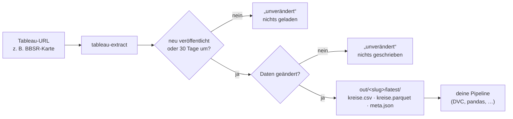
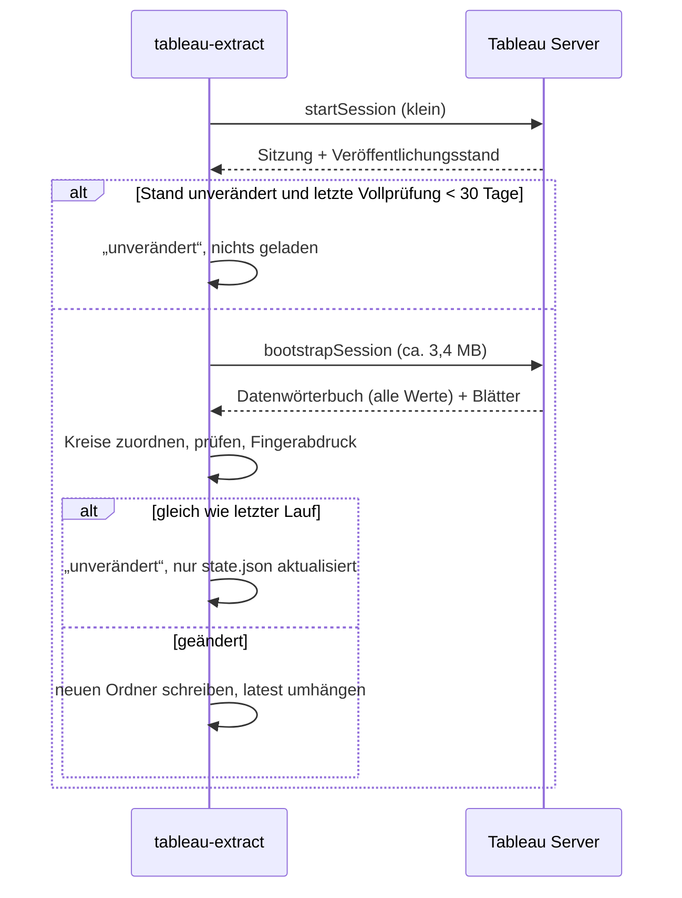

# tableau-extract

Holt die **Daten hinter einer Tableau-Karte** (z. B. BBSR-Wohnungsneubaubedarf je Landkreis) und legt sie als Tabelle ab: eine Zeile je Kreis, Werte exakt wie im Tableau-Datenmodell, nicht von Farben oder Tooltips abgelesen.

[](https://github.com/trosinde/tableau-extract/actions/workflows/ci.yml)
[](https://github.com/trosinde/tableau-extract/actions/workflows/notebook.yml)

## Auf einen Blick



| | |
|---|---|
| **Eingabe** | URL einer Tableau-Ansicht (`https://<server>/t/<site>/views/<Arbeitsmappe>/<Blatt>`) |
| **Ausgabe** | `kreise.csv` und `kreise.parquet` (eine Zeile je Kreis, `ags5` + alle Felder), `meta.json` (Herkunft, Prüfsummen, Prüfungen) |
| **Geladen** | nur, wenn die Arbeitsmappe neu veröffentlicht wurde (kleine Vorabprüfung); spätestens alle 30 Tage trotzdem voll, falls die Quelle still aktualisiert wird |
| **Neu geschrieben** | nur, wenn sich mindestens ein Wert geändert hat |
| **Läuft** | lokal bzw. im Homelab. Aus Rechenzentren (GitHub Actions, Cloud-VMs, Colab) sperrt der BBSR-Server mit 403, siehe [Zugangsbericht](docs/zugangsbericht.md) |

## Installation

**Im Jupyter-Notebook** (JupyterLab oder VS Code, Python ≥ 3.11):

```python
%pip install "git+https://github.com/trosinde/tableau-extract.git@v0.1.0"
```

Mit Browser-Rückfallweg (nur nötig, wenn der direkte Abruf an einem Server scheitert):

```python
%pip install "tableau-extract[browser] @ git+https://github.com/trosinde/tableau-extract.git@v0.1.0"
!playwright install chromium
```

**Kommandozeile** in einer eigenen Umgebung:

```bash
uv tool install "git+https://github.com/trosinde/tableau-extract.git@v0.1.0"
# oder: pip install "git+https://github.com/trosinde/tableau-extract.git@v0.1.0"
```

**Für die Entwicklung:**

```bash
git clone https://github.com/trosinde/tableau-extract.git
cd tableau-extract
uv sync --all-groups --all-extras   # Tests, Lint, Notebook-Werkzeuge, Playwright
```

Die Kreis-Referenzlisten (Destatis, Gebietsstand 31.12.2023 und 31.12.2024) werden mitinstalliert. Eine eigene Fassung unter `./config/kreise_<JJJJ>.csv` oder per `--referenz` hat Vorrang.

## Im Jupyter-Notebook

```python
import pandas as pd

from tableau_extract import extract, list_view

URL = (
    "https://tableau.bbsr.bund.de/t/bbr/views/"
    "Wohnungsneubaubedarfe_insgesamt_2023_bis_2030pa_krs_FINAL/DWohnungsneubaubedare_insgesamt"
)

list_view(URL)                                   # Blätter, Felder mit Rollen, Filter
r = extract(URL, out="out", check_sum=320_000)
r                                                # kompakte Zusammenfassung
```

```
ExtractResult
  Status           neu
  Weg              vizql
  Blatt            Karte
  Zeilen           400
  Vollständigkeit  400/400 Kreise, Gebietsstand 31.12.2023
  Gegenprobe       p_wohnungsneubaubedarf_2330_we_pa: 316490.0 statt 320000.0 (-1.1 %)
  Veröffentlicht   2025-03-05T15:16:42.359Z
  Pfad             out/bbr-wohnungsneubaubedarfe_…/20261024T143032Z_47c475fc
```

```python
df = r.df.copy()                                  # Messwerte exakt als Decimal
je_ew = "p_wohnungsneubaubedarf_2330_we_pa_je_10000ew"
df[je_ew] = pd.to_numeric(df[je_ew])              # für Rechnungen in float umwandeln
df.nlargest(5, je_ew)[["ags5", "kreis_name", je_ew]]

extract(URL, out="out").status                    # 'unverändert'
```

- Das vollständige Beispiel steht in [`notebooks/schnellstart.ipynb`](notebooks/schnellstart.ipynb). CI führt es bei jeder Änderung aus dem gebauten Paket aus, mit einer gespeicherten Serverantwort (`TABLEAU_EXTRACT_REPLAY=notebooks/beispiel_raw`), weil GitHub Actions die Quelle nicht erreicht.
- Frühere Läufe lassen sich ohne Netz neu auswerten: `extract(URL, replay="out/<slug>/latest/raw")`.

## Kommandozeile

### Ansicht ansehen

```bash
tableau-extract "https://tableau.bbsr.bund.de/t/bbr/views/Wohnungsneubaubedarfe_insgesamt_2023_bis_2030pa_krs_FINAL/DWohnungsneubaubedare_insgesamt" --list
```

```
Blatt: Impressum  [1 Zeilen]
  SUM(Krs2022)                                                 messwert   integer  → krs2022
Blatt: Karte  [400 Zeilen]  (gewählt)
  COLLECT(Geometrie)                                           geometrie  spatial  → geometrie
  P Wohnungsneubaubedarf 2330 We Pa Je 10000Ew (Round) (Klassen) klasse     cstring · gerundet  → p_wohnungsneubaubedarf_2330_we_pa_je_10000ew_klassen
  krs23                                                        schluessel integer  → krs23
  krsname23                                                    name       cstring  → krsname23
  slk2023                                                      dimension  cstring  → slk2023
  SUM(P Wohnungsneubaubedarf 2330 We Pa Je 10000Ew (Round))    messwert   real · gerundet  → p_wohnungsneubaubedarf_2330_we_pa_je_10000ew
  SUM(P Wohnungsneubaubedarf 2330 We Pa (Round))               messwert   real · gerundet · formatierter Text  → p_wohnungsneubaubedarf_2330_we_pa
  Latitude (generated)                                         geometrie  real  → latitude_generated
  Longitude (generated)                                        geometrie  real  → longitude_generated
Filter/Parameter: keine
Veröffentlicht: 2025-03-05T15:16:42.359Z
Weg: vizql
```

### Daten holen

```bash
tableau-extract "<url>" --check-sum 320000
```

```
Weg csv: gescheitert, HTTP 404 – HTTP 404, Tableau, missing-view
Weg vizql: ok
Gegenprobe p_wohnungsneubaubedarf_2330_we_pa: Summe 316490, Soll 320000, Abweichung -1.1 %
Vollständigkeit: 400/400 Kreise (Gebietsstand 31.12.2023)
neu: out/bbr-wohnungsneubaubedarfe_…/20261024T142909Z_47c475fc (400 Zeilen)
```

Ein zweiter Lauf ohne neue Veröffentlichung:

```
unverändert (Veröffentlichungsstand 2025-03-05T15:16:42.359Z), nichts geladen
```

### Optionen

| Option | Wirkung |
|---|---|
| `--list` | Blätter, Felder, Filter anzeigen; nichts schreiben |
| `--sheet "Karte"` | Blatt erzwingen (sonst automatisch: das mit Kreisschlüssel bzw. Geometrie) |
| `--all-filters` | je Filter-/Parameterwert ein Abzug; eine Spalte je Filter (nur Weg `vizql`) |
| `--method csv\|vizql\|download\|network` | nur diesen Weg versuchen |
| `--out out/` | Basisverzeichnis (alternativ `TABLEAU_EXTRACT_OUT`) |
| `--force` | voll laden, auch wenn der Veröffentlichungsstand unverändert ist |
| `--full-check-days 30` | spätestens nach so vielen Tagen trotzdem voll laden und vergleichen |
| `--check-sum 320000 [--check-field <spalte>]` | Summe über alle Kreise gegen Sollwert prüfen, Abweichung in % |
| `--gebietsstand 2023` | Referenzliste der Kreise erzwingen (sonst aus Feldnamen wie `krs23`) |
| `--referenz <datei>` | eigene Referenzliste (`ags5;name;typ`) |
| `--replay <raw-ordner>` | gespeicherte Rohantworten neu auswerten, ohne Abruf (alternativ `TABLEAU_EXTRACT_REPLAY`) |
| `--timeout 60`, `--quiet`, `--version` | |

Weitere Umgebungsvariablen: `TABLEAU_EXTRACT_USER_AGENT`, `TABLEAU_EXTRACT_MIN_INTERVAL` (mindestens 1 s).

### Exit-Codes

| Code | Bedeutung |
|---|---|
| 0 | neue Daten geschrieben **oder** unverändert |
| 1 | ungültige Eingabe (keine Tableau-URL, unbekanntes Blatt, …) oder unerwarteter Fehler |
| 2 | Quelle gesperrt: kein Weg lieferte Daten, Bericht der Fehlversuche, keine Tabelle |
| 3 | Kreise nicht eindeutig zuordenbar: Bericht mit Kandidaten, keine Tabelle |

## Ausgabe

```
out/<slug>/
  20261024T142909Z_47c475fc/
    kreise.csv        # ags5;kreis_name;<feld>;<feld>_typ;…  (UTF-8, ';', Dezimalpunkt)
    kreise.parquet    # gleiche Daten, Messwerte als decimal128, meta.json im Schema
    data_raw.csv      # Werte genau wie von Tableau geliefert (z. B. "23,000", 11000000)
    meta.json         # URL, Weg, Blatt, Filter, Felder (Original ↔ Spalte), Prüfsummen, Fehlversuche
    raw/              # unveränderte Server-Antworten (startSession.json, bootstrapSession.txt)
  latest -> 20261024T142909Z_47c475fc
  state.json          # Veröffentlichungsstand, letzte Vollprüfung, Fingerabdruck
```

Beispielzeilen `kreise.csv` (BBSR, Spalten gekürzt):

```
ags5;kreis_name;…_klassen;…_klassen_typ;slk2023;slk2023_typ;…_je_10000ew;…_je_10000ew_typ;p_wohnungsneubaubedarf_2330_we_pa;…_typ
11000;Berlin, Stadt;60 bis unter 75;klasse;Kreisfreie Stadt;wert;61.3;wert;23000;wert
05314;Bonn, Stadt;45 bis unter 60;klasse;Kreisfreie Stadt;wert;49.4;wert;1600;wert
14521;Erzgebirgskreis;bis unter 15;klasse;Landkreis;wert;6.6;wert;200;wert
```

- `<feld>_typ` ist `klasse` bei Klassenfeldern (z. B. „60 bis unter 75“), sonst `wert`.
- Sonderwerte (`*`, `null`, leer) bleiben in `kreise.csv` leer; das Originalzeichen steht in `data_raw.csv`.
- **Genauigkeit:** Das BBSR rundet die Werte bereits in der Arbeitsmappe (Felder heißen `(Round)`, in `meta.json` als `im_datenmodell_gerundet` vermerkt). Wir liefern sie exakt so; genauere Zahlen enthält die Karte nicht.
- **`raw/` nicht veröffentlichen:** Die Rohantworten enthalten Angaben des Betreibers, z. B. den Zugangstoken seines Kartendienstes.

## So funktioniert es

Das Tool probiert vier Wege nacheinander; der erste, der Daten liefert, gewinnt. Kein Weg umgeht Logins, Sperren oder Zustimmungsdialoge. Abgerufen wird mit eigener Kennung (`tableau-extract/<version>`), höchstens einer Anfrage pro Sekunde und Backoff bei Serverfehlern.

| Weg | Wie | BBSR-Karte |
|---|---|---|
| A `csv` | Tableau-Datenexport `…/<blatt>.csv` | gesperrt (404 `missing-view`) |
| B `vizql` | VizQL-Sitzung wie der Browser (`startSession`, `bootstrapSession`), Werte aus dem Datenwörterbuch | **Hauptweg**, ca. 2–3 s |
| C `download` | prüft das Download-Menü auf „Daten“/„Kreuztabelle“ | nicht angeboten |
| D `network` | Browser (Playwright) lädt die Seite, Antworten werden mitgeschnitten | Rückfallweg |



Details und weitere Diagramme: [design.md](openspec/changes/add-tableau-extract/design.md).

## In einer DVC-Pipeline

```yaml
# dvc.yaml
stages:
  bbsr_neubaubedarf:
    cmd: >-
      tableau-extract
      "https://tableau.bbsr.bund.de/t/bbr/views/Wohnungsneubaubedarfe_insgesamt_2023_bis_2030pa_krs_FINAL/DWohnungsneubaubedare_insgesamt"
      --out data/raw/tableau
      --check-sum 320000
    outs:
      - data/raw/tableau/bbr-wohnungsneubaubedarfe_insgesamt_2023_bis_2030pa_krs_final-dwohnungsneubaubedare_insgesamt/latest/kreise.parquet:
          persist: true
    always_changed: true   # Quelle immer prüfen; Folgestufen laufen nur, wenn sich kreise.parquet ändert
```

## Projektaufbau

```
src/tableau_extract/        Paket: CLI, API, Wege (methods/), Parser, Normalisierung, Kreiszuordnung
src/tableau_extract/data/   Kreis-Referenzlisten (Destatis), werden mitinstalliert
tests/                      Tests ohne Netzwerk mit Fixtures; Live-Test mit -m live
notebooks/                  Beispiel-Notebook und Offline-Daten, in CI ausgeführt
scripts/                    Referenzliste, Notebook erzeugen und ausführen
probe/                      Zugangsprüfung (Schritt 0)
docs/zugangsbericht.md      Ergebnis der Zugangsprüfung
openspec/                   Spezifikation (OpenSpec)
```

## Entwicklung

Die Anforderungen stehen in OpenSpec: [proposal](openspec/changes/add-tableau-extract/proposal.md) · [spec](openspec/changes/add-tableau-extract/specs/tableau-extract/spec.md) · [notebook-spec](openspec/changes/add-tableau-extract/specs/notebook-usage/spec.md) · [design](openspec/changes/add-tableau-extract/design.md) · [tasks](openspec/changes/add-tableau-extract/tasks.md)

```bash
uv run pytest                     # Tests ohne Netzwerk
uv run pytest -m live             # Live-Test gegen BBSR (nur lokal) inkl. Notebook ohne Replay
uv run ruff check && uv run ruff format --check src tests && uv run mypy src
uv run python scripts/make_notebook.py   # Notebook neu erzeugen
```

## Lizenz

Code: MIT, siehe [LICENSE](LICENSE). Kreis-Referenzlisten: © Statistisches Bundesamt (Destatis), Datenlizenz Deutschland – Namensnennung – Version 2.0. Die abgerufenen Daten unterliegen den Bedingungen des jeweiligen Anbieters (hier BBSR).
