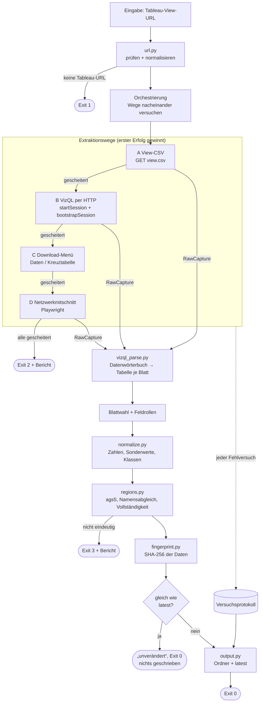
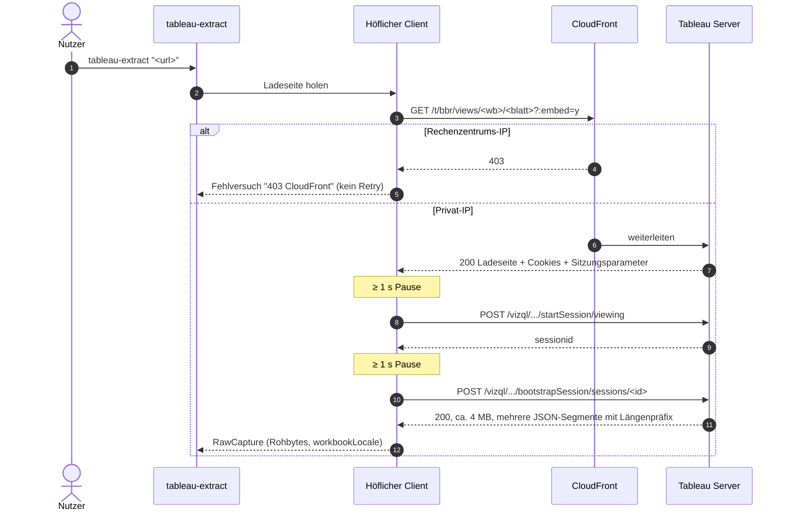
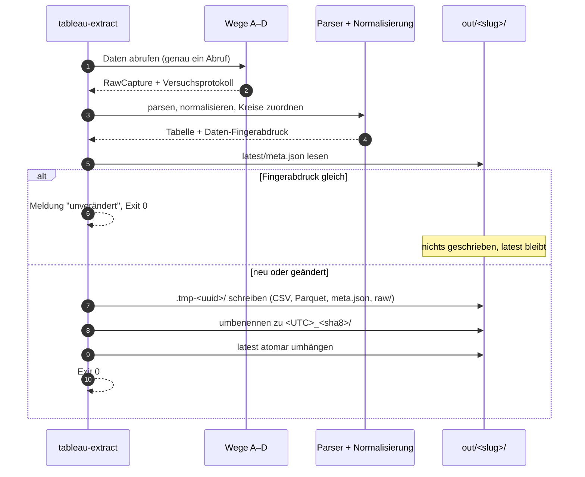
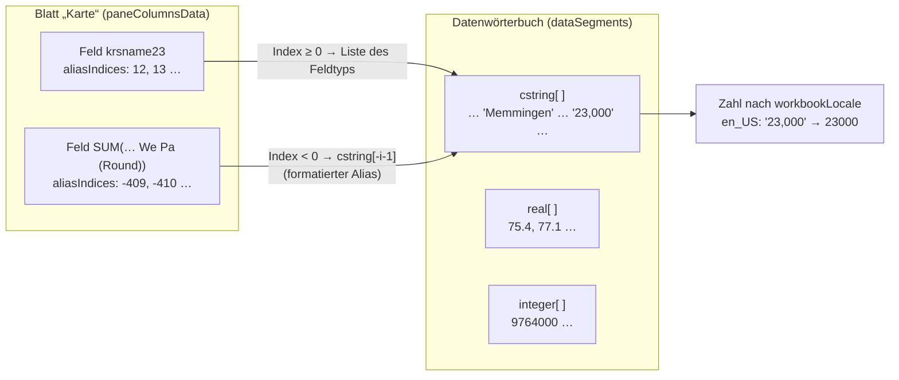
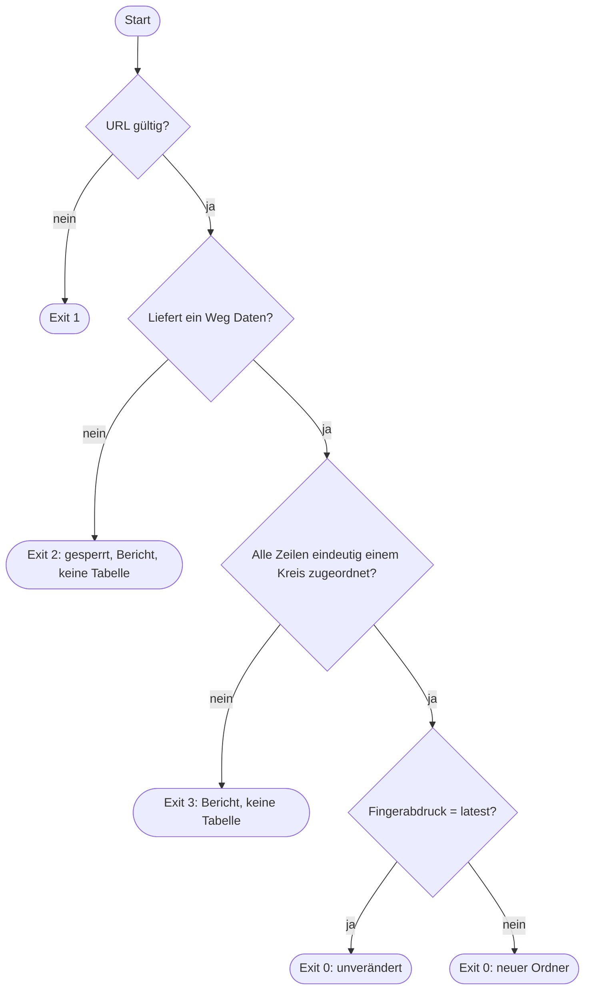

# Design

## Context

Motivation siehe `proposal.md`. Grundlage sind die Befunde aus `docs/zugangsbericht.md` und eine Auswertung der lokal mitgeschnittenen `bootstrapSession` der BBSR-Karte:

- **Ablauf der Ansicht:**
  - `GET /t/bbr/views/<wb>/<sheet>?:embed=y` liefert 200 und eine 5 KB große Ladeseite.
  - Danach folgen `POST /vizql/t/bbr/w/<wb>/v/<sheet>/startSession/viewing` und `POST .../bootstrapSession/sessions/<id>`.
  - Die Antwort ist im Format `<länge>;<json><länge>;<json>`, 3–5 MB groß und ändert sich bei jedem Abruf (Sitzungs-IDs).
- **Datenwörterbuch** (`secondaryInfo.presModelMap.dataDictionary...dataSegments`):
  - Werte nach Typ: 401 Ganzzahlen, 1085 Dezimalwerte, 1301 Texte, 400 Polygone.
  - Je Blatt (`vizData...presModelMap.<Blatt>.paneColumnsData`) verweisen `aliasIndices`/`valueIndices` in diese Listen.
  - **Negative Indizes** zeigen auf formatierte Texte (Index `-i-1` in der Textliste).
- **Blatt `Karte`:**
  - `krs23` als Ganzzahl in Gemeindeform, z. B. `9764000`
  - `krsname23`, `slk2023` (Siedlungsstrukturtyp)
  - Wert je 10 000 Einwohner als Dezimalzahl, z. B. `75.4`
  - Absolutwert **nur als formatierter Text** im Gebietsschema der Arbeitsmappe, z. B. `"23,000"`
  - Klassenfeld (Text), Geometrie, generierte Lat/Lon
- **Blatt `Impressum`:** nur `SUM(Krs2022)`.
- **Filter und Parameter:** keine.
- `workbookLocale` ist `en_US`.
- **Gegenprobe:** Die Summe der Absolutwerte ist 316 490, das BBSR nennt ~320 000.
- **Sperren:**
  - `<view>.csv` liefert 404 `missing-view`.
  - Das Download-Menü bietet nur Bild, PDF und PowerPoint.
  - Rechenzentrums-IPs erhalten 403 von CloudFront.

## Goals / Non-Goals

**Goals:**

- Exakte Kreiswerte über Weg B (HTTP) mit Weg D (Playwright) als Rückfall.
- Weg A und C werden versucht und ihr Scheitern sauber protokolliert.
- Robuster eigener Parser für das VizQL-Format, getestet mit Fixtures.
- Änderungserkennung auf Datenebene, damit die Pipeline nur bei echten Änderungen neu rechnet.

**Non-Goals:**

- Interaktion mit der Viz über `--all-filters` hinaus (Auswahl, Drill-down, Paginierung).
- Geometrien ausgeben. Sie werden zur Blattwahl genutzt, aber nicht in `kreise.csv` geschrieben, weil sie für Kreiswerte unnötig und sehr groß sind.
- Betrieb in der Cloud: CloudFront-Sperre, siehe Zugangsbericht.
- Weg C (Crosstab-Download) bis zum echten Download ausbauen. Er prüft nur, ob „Daten“ oder „Kreuztabelle“ angeboten werden, und protokolliert das. Der Ausbau folgt erst, wenn eine Ansicht das freigibt.

## Diagramme

### Bausteine und Datenfluss



### Ablauf Weg B (VizQL per HTTP)



### Gesamtlauf mit Änderungserkennung



### Auflösung der Werte aus dem Datenwörterbuch



## Decisions

### D1 Aufbau: Abrufen → Rohdaten → Parsen → Normalisieren → Schreiben

Jeder Weg liefert ein einheitliches `RawCapture`: Rohdateien als Bytes, Gebietsschema und Protokoll. Ein gemeinsamer Parser macht daraus eine `SheetTable` (Spalten mit Originalname, Datentyp, Rohwerten). Normalisierung, Kreiszuordnung, Fingerabdruck und Schreiben arbeiten nur auf dieser Tabelle.

Module: `url.py`, `http.py` (höflicher Client), `methods/{csv,vizql,download,network}.py`, `vizql_parse.py`, `normalize.py`, `regions.py`, `fingerprint.py`, `output.py`, `api.py`, `cli.py`.

*Alternative:* je Weg eine eigene Pipeline. Verworfen, weil B und D dasselbe Format liefern und die Exaktheitsregeln nur an einer Stelle gelten sollen.

### D2 Weg B: eigener VizQL-Client und -Parser, TableauScraper nur als Referenz

Ablauf:

1. Ladeseite holen, um Cookies und `tsConfigContainer` (Sitzungsparameter) zu erhalten.
2. `startSession/viewing`
3. `bootstrapSession` mit `sheet_id`, `worksheetPortSize`, `dashboardPortSize`, `clientDimension` und `renderMapsClientSide=true`, wie der Browser es sendet.
4. Den Parser schreiben wir selbst (ca. 200 Zeilen): Segmente zerlegen, Datenwörterbuch nach Typ, Blätter → `vizDataColumns` → `paneColumnsList`, negative Indizes auf formatierte Texte.

*Alternative:* `TableauScraper` als Abhängigkeit. Verworfen: Die Bibliothek ist kaum gepflegt, zieht schwere Abhängigkeiten nach und verdeckt die Alias-Logik, die hier für die Exaktheit entscheidend ist. Wir übernehmen ihre bekannte Struktur nur als Vorlage.

**Offen bis zur Umsetzung:** Ob Weg B per reinem HTTP ohne JavaScript-Ausführung gelingt, ist noch nicht einzeln geprüft (Zugangsbericht). Deshalb gibt es Weg D.

### D3 Weg D: Playwright als optionales Extra

Headless Chromium lädt die Ansicht und zeichnet die `bootstrapSession`-Antwort auf. Weitere VizQL-Antworten werden nur bei `--all-filters` erfasst. Danach läuft derselbe Parser wie bei Weg B.

Playwright ist das optionale Extra `tableau-extract[browser]`. Fehlt es, wird Weg D mit „Playwright nicht installiert“ protokolliert. Weg C nutzt dieselbe Browser-Sitzung, um das Download-Menü zu prüfen, ohne eine zweite Seite zu laden.

### D4 Werte und Zahlen

- `data_raw.csv` enthält je Feld genau den Wert aus dem Datenwörterbuch: Zahlen in ihrer JSON-Darstellung, formatierte Aliase als Text.
- In `kreise.csv` werden Texte von Messfeldern nach `workbookLocale` geparst, mit `decimal.Decimal` statt float:
  - `en_*`: `,` ist Tausender-, `.` Dezimalzeichen.
  - `de_*`: umgekehrt.
- Werte, die in diesem Format nicht eindeutig lesbar sind, gelten als Fehler und werden nicht geraten.
- Parquet speichert Messwerte als `decimal128` mit der größten gelieferten Nachkommastellenzahl, damit keine Float-Rundung entsteht. In CSV steht der Decimal-Text.
- **Sonderwerte:** `null`, `%null%`, `*`, `-`, `` und `%missing%` werden leer.

*Alternative:* float64. Verworfen, weil `75.4` als float nicht exakt ist und dann die Gleichheit beim Fingerabdruck wackeln kann.

### D5 Feldrollen und Spaltennamen

**Rollen** werden aus Datentyp und Aggregation abgeleitet:

| Rolle | Erkennung |
|---|---|
| Messfeld | `SUM(...)`, `AVG(...)`, … oder numerischer Typ |
| Dimension | Text, Ganzzahl ohne Aggregation |
| Schlüssel | Name passt auf `krs|ags|kreis.*schl|rs|ars` und Werte sind 4–8-stellig |
| Name | Name passt auf `name|kreis` und Typ ist Text |
| Klasse | Text mit Muster `bis unter`, `und mehr`, `–`, `<`, `>` oder Feldname endet auf `(Klassen)`/`(bins)` |
| Geometrie | `spatial`, `Latitude/Longitude (generated)`, `COLLECT(...)`; wird nicht ausgegeben |

**Spaltennamen:** Aggregation entfernen, den Zusatz `(Round)` entfernen, andere Klammerzusätze (z. B. `(Klassen)`) als Wortteil behalten, snake_case, bei Kollision ein Suffix `_2`. Beispiel: `SUM(P Wohnungsneubaubedarf 2330 We Pa (Round))` → `p_wohnungsneubaubedarf_2330_we_pa`. Der Originalname und der Hinweis „im Datenmodell gerundet“ (aus `(Round)`) stehen in `meta.json`.

`--list` zeigt die abgeleiteten Rollen, damit Fehlzuordnungen sichtbar sind.

### D6 Kreiszuordnung und Referenzliste

- **Referenz:** Destatis GV-ISys, Kreise nach Gebietsstand, eingecheckt als `data/kreise_<JJJJ>.csv` (`ags5;name;typ`). Zunächst für 31.12.2023, weil `krs23` und `krsname23` auf den Gebietsstand 2023 deuten. Die Herkunft und die Prüfsumme der Quelldatei stehen in `data/README.md`.
- **Gebietsstand:** aus einer Jahreszahl im Schlüssel- oder Namensfeld (`krs23` → 2023). Sonst die neueste Liste. Mit `--gebietsstand JJJJ` lässt er sich erzwingen.
- **Schlüssel:** Ganzzahl bzw. Text → Ziffern; 7–8 Stellen → auf 8 auffüllen, erste 5; 4–5 Stellen → auf 5 auffüllen. Sonst ungültig.
- **Namen**, nur wenn kein Schlüssel vorhanden ist:
  - Kleinschreibung, `ä/ae`, `ö/oe`, `ü/ue`, `ß/ss` vereinheitlichen.
  - Zusätze in Typ-Hinweise umwandeln: `, Landkreis`, `Landkreis `, `Kreis `, `, Stadt`, `Stadtkreis`, `, kreisfreie Stadt`.
  - Zuordnung nur bei genau einem Kandidaten. Sonst Exit 3 mit Bericht.

### D7 Fingerabdruck für die Änderungserkennung

```
SHA-256( JSON kanonisch {
  "sheet", "filter_state",
  "fields": [ (original_name, column, dtype) ... ],
  "rows": sortiert nach (ags5, Filterspalten), Werte als Text aus data_raw
})
```

- Er wird **nach dem Abruf und vor dem Schreiben** gebildet und mit `meta.json:data_fingerprint` hinter `latest` verglichen. Bei Gleichheit wird nichts geschrieben.
- `sha8` im Ordnernamen sind die ersten 8 Zeichen dieses Fingerabdrucks.
- Die Prüfsummen der Rohantworten stehen weiterhin in `meta.json`, entscheiden aber nicht über „geändert“, denn sie enthalten Sitzungs-IDs.
- **Abweichung vom Auftrag:** Der Auftrag sah die Prüfsumme der Rohantworten vor. Damit würde jeder Lauf als geändert gelten, weil sich die Rohantworten bei jedem Abruf unterscheiden.

*Alternative:* ein billiger Vorab-Check (ETag der Ladeseite, Änderungsdatum der Arbeitsmappe), um auch den Abruf zu sparen. Verworfen:

- Der ETag der Ladeseite blieb bei Wiederholung zwar gleich, gehört aber zur Ladeseite, nicht zu den Daten.
- Das Änderungsdatum steht nur in der REST-API, und die verlangt eine Anmeldung.

Ein Abruf der `bootstrapSession` (ca. 4 MB) je Lauf ist daher nötig. Geschrieben und nachgelagert neu gerechnet wird nur bei echter Änderung.

### D8 Höflicher HTTP-Client

- Eine `requests.Session` je Host.
- User-Agent `tableau-extract/<version> (+<repo-url>)`.
- Drossel auf mindestens 1 s zwischen Anfragen.
- Retry bei 429, 5xx und Timeouts mit Backoff 2/4/8 s (`Retry-After` wird beachtet).
- Kein Retry bei 401, 403 oder 404.
- Weiterleitungen auf `signin|login|auth` gelten als „Anmeldung erforderlich“.

### D9 Ausgabe und Atomizität

- Der Lauf schreibt zuerst in `out/<slug>/.tmp-<uuid>/` und benennt den Ordner danach um.
- `latest` ist ein relativer Symlink, der atomar ersetzt wird (neuer Symlink, dann `os.replace`). So entsteht nie ein halber Ordner hinter `latest`.
- **Slug:** `<site>-<arbeitsmappe>-<blatt>` in Kleinbuchstaben, nur ASCII.
- **Parquet:** `meta.json` liegt zusätzlich als Schema-Metadatum `tableau_extract` vor.

### D10 CLI, Exit-Codes, Konfiguration



- `argparse`; die Optionen entsprechen dem Auftrag, ergänzt um `--check-field`, `--gebietsstand`, `--timeout` und `--quiet`.
- Umgebungsvariablen: `TABLEAU_EXTRACT_OUT`, `TABLEAU_EXTRACT_USER_AGENT`, `TABLEAU_EXTRACT_MIN_INTERVAL`.
- Exit-Codes:

  | Code | Bedeutung |
  |---|---|
  | 0 | neu oder unverändert |
  | 1 | Eingabe- oder unerwarteter Fehler |
  | 2 | gesperrt |
  | 3 | Kreise nicht eindeutig zuordenbar |

### D11 Tests

- **Fixtures** in `tests/fixtures/`:
  - eine gekürzte `bootstrapSession` der BBSR-Karte (die Geometrie-Texte durch Platzhalter ersetzt, sonst unverändert, damit klein genug für das Repo)
  - eine synthetische `bootstrapSession` mit `de_DE`, Filter und Sonderwerten
  - eine View-CSV als Beispiel für Weg A
  - aufgezeichnete Fehlantworten (403 CloudFront, 404 `missing-view`)
- Das Kürzen der Fixture übernimmt ein kleines Skript (`tests/fixtures/make_fixture.py`).
- HTTP wird mit `responses` gemockt, ohne Netzwerk.
- Ein Live-Test `@pytest.mark.live` läuft standardmäßig nicht und prüft die BBSR-URL (400 Zeilen, Summe ±5 % von 320 000).

## Risks / Trade-offs

- **Tableau ändert das VizQL-Format** → Der Parser prüft die erwarteten Schlüssel und scheitert mit einer klaren Meldung statt mit Teil-Daten. Fixtures fangen Regressionen; der Live-Test zeigt Formatwechsel.
- **Weg B braucht Browser-Kontext** (Token aus JavaScript) → Weg D als Rückfall; der Grund steht im Protokoll.
- **Formatierte Aliase sind gerundet bzw. formatiert** → Wir liefern sie wie im Modell und vermerken `quelle_wert = formatierter_alias` je Feld in `meta.json`. Genauere Werte gibt diese Ansicht nicht her.
- **Rollenerkennung irrt** (z. B. eine Kennzahl als Schlüssel) → Die Vollständigkeitsprüfung schlägt dann an; `--list` zeigt die Rollen. Der Schlüssel lässt sich bei Bedarf mit einer Option erzwingen (spätere Erweiterung, nicht in diesem Change).
- **Kein Lauf aus GitHub Actions möglich** → Betrieb lokal bzw. im Homelab; dokumentiert in der README.
- **Ein Abruf je Lauf, auch wenn unverändert** (ca. 4 MB) → bei der vorgesehenen Frequenz (Pipeline-Lauf, nicht minütlich) unkritisch und durch die Drosselung höflich.

## Migration Plan

Neues Paket, keine Migration. `probe/` bleibt unverändert.

## Open Questions

- **Gebietsstand der Referenzliste:** Wir nehmen 31.12.2023, passend zu `krs23`. Ob das BBSR einen anderen Stichtag meint, ändert nur die eingecheckte Datei, nicht das Verhalten.
